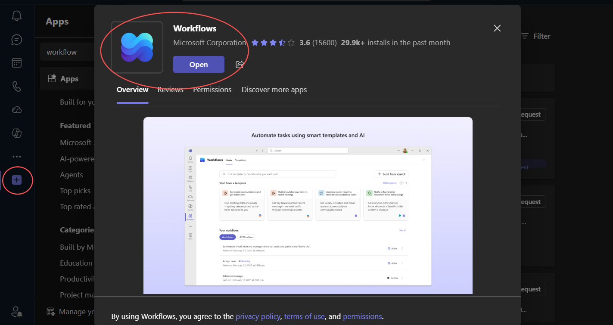
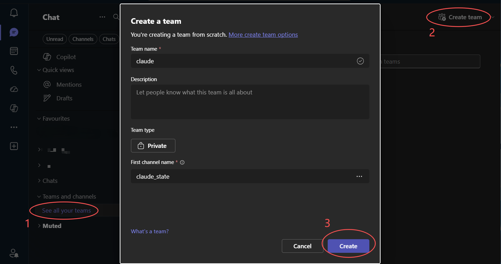
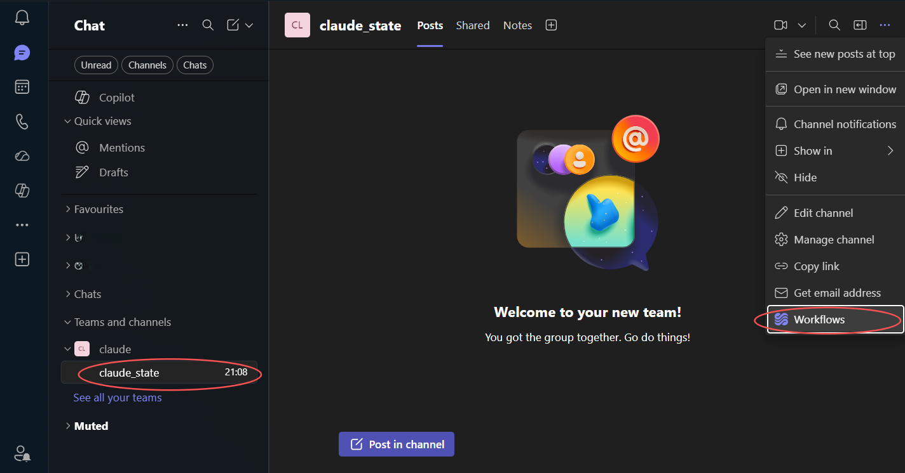
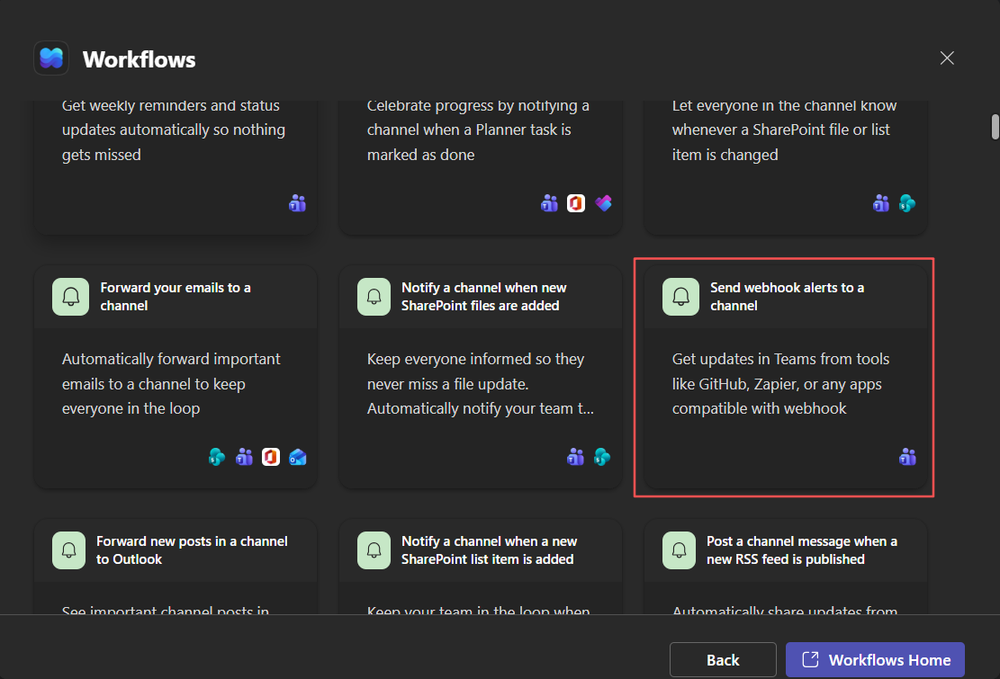
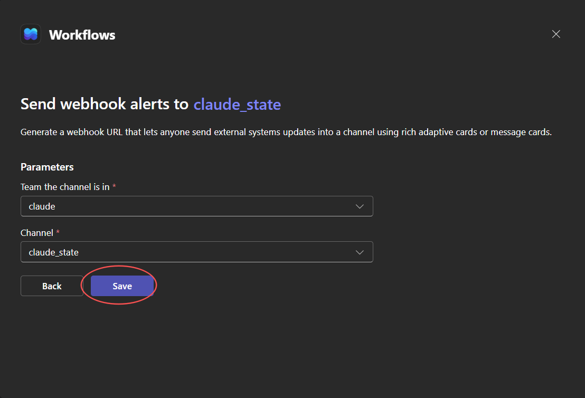
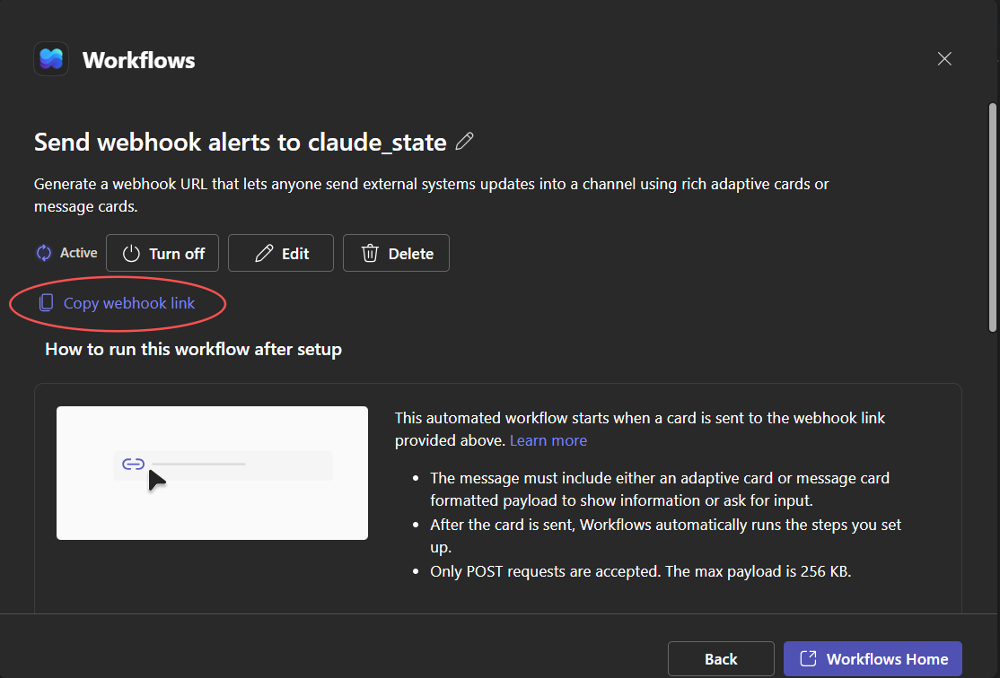
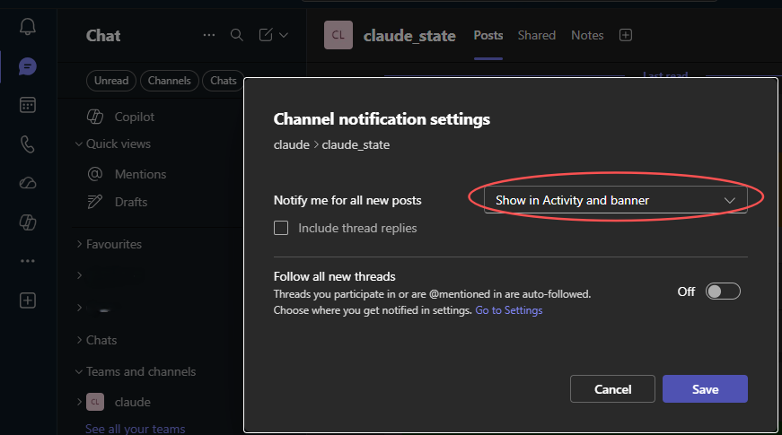

# Claude Code Teams Notifier — Python 版

<div align="center">

**在 Claude Code 需要确认 / 任务完成时,自动给 Teams 发消息(纯 Python,非阻塞)**

[](#)
[](#)

</div>

---

## ✨ 功能特性

🔔 **两个关键节点通知** —— 通过 Claude Code hooks 自动捕获,无需手动干预:
- 🟠 **等待操作** —— 弹出权限确认时(`PermissionRequest`),提醒你切回终端处理。
- ✅ **任务完成** —— 主循环结束时(`Stop`),告诉你这一轮已处理完。

⚡ **非阻塞** —— hook 进程只负责派生一个脱离的后台 worker 然后立刻退出,真正的网络 POST(最长 10s 超时)在后台完成,**绝不卡住 Claude Code**。

🏷️ **带项目名** —— 消息标题里带上当前项目目录名(取自 `CLAUDE_PROJECT_DIR`),多个会话同时跑也能分清是哪个。

📦 **轻量** —— 仅依赖 `requests`(发 HTTP),其余全是标准库。

---

## 📦 运行要求

- Python **3.8+**
- `pip install requests`
- 一个 Teams **Power Automate / Workflow** 的 Webhook URL(用于接收 Adaptive Card)

---

## 🚀 快速开始

### 1. 配置 Teams Workflow

通知通过 Teams 的 **Workflows(Power Automate)** 插件接收,下面一步步拿到 Webhook URL。

**(1) 安装 Workflows 插件**

在 Teams 客户端的应用市场里搜索并安装 **Workflows** 插件。



**(2) 创建一个团队(Team)用于接收消息**

新建或选择一个团队 / 频道,通知消息会发到这里。



**(3) 新建 Workflow**

进入 Workflows,点击新建一个工作流。



**(4) 选择 webhook 模板并绑定频道**

选择 **send webhook alerts to a channel** 模板,把它绑定到上一步创建的频道。





**(5) 复制 Webhook 链接**

工作流创建完成后,复制生成的 Webhook URL —— 这就是下一步要配置到环境变量 `TEAMS_WORKFLOW_URL` 的地址。



**(6) 开启消息通知(可选)**

打开频道的桌面通知,这样收到消息时会有弹窗提醒。



### 2. 配置 Workflow URL

`notify.py` 从环境变量 `TEAMS_WORKFLOW_URL` 读取 Webhook 地址(URL 带签名,不要写进代码仓库)。未设置时跳过 Teams 通知。

Windows(PowerShell,对当前用户永久生效,设置后需重启 Claude Code):

```powershell
[Environment]::SetEnvironmentVariable('TEAMS_WORKFLOW_URL', '<上一步复制的 Webhook URL>', 'User')
```

Linux / macOS:

```bash
export TEAMS_WORKFLOW_URL='<上一步复制的 Webhook URL>'
```

### 3. 配置 Claude Code hooks

编辑 Claude Code 配置文件:

- **Windows**:`%USERPROFILE%\.claude\settings.json`
- **macOS / Linux**:`~/.claude/settings.json`

把 `<项目路径>` 替换成你本地仓库的绝对路径,按需把 `python` 换成可用的解释器:

```json
{
  "hooks": {
    "PermissionRequest": [
      {
        "matcher": "",
        "hooks": [
          { "type": "command", "command": "python <项目路径>/notify.py waiting" }
        ]
      }
    ],
    "Stop": [
      {
        "matcher": "",
        "hooks": [
          { "type": "command", "command": "python <项目路径>/notify.py done" }
        ]
      }
    ]
  }
}
```

两个事件对应两条消息:

| Hook | 触发时机 | 事件 | 消息 |
|------|----------|------|------|
| `PermissionRequest` | 弹出权限授权请求时 | `waiting` | `[项目名] 等待操作` |
| `Stop` | 主循环结束(回到等待用户输入) | `done` | `[项目名] 任务完成` |

> **为什么用 `PermissionRequest` 而不是 `Notification`**:`Notification` 既会在「需要授权」时触发,也会在「闲置约 60 秒」时触发,会在你纯粹离开时误发。`PermissionRequest` 语义清晰,只在真正需要确认时触发。
>
> **路径写法**:Windows 上若用 Git Bash / WSL 风格路径(如 `/e/RealtekTool/...`),需确保被调用的 `python` 能解析它;否则用反斜杠绝对路径(`E:\\RealtekTool\\...`,JSON 里反斜杠要转义)。

### 4. 手动测试 / 调试

不依赖 Claude Code 也可以直接验证:

```bash
# 前台路径:派生后台 worker 后立刻退出(应当秒回)
python notify.py waiting
python notify.py done

# worker 路径:在当前进程里直接发(用于排查发送是否成功)
python notify.py --worker done "项目名"
```

---

## ⚙️ 非阻塞原理

Claude Code 的 hook 是**同步**执行的 —— 它会等 hook 命令退出后才继续。如果在 hook 里直接 `requests.post(..., timeout=10)`,网络慢时最坏会把 hook 卡住 **10 秒**,确认框延迟弹出、收尾变慢。

`notify.py` 的做法:

```
hook 触发 → 前台进程 spawn 脱离的后台 worker → 前台立刻退出(~0.5s)
                                  └→ worker 独立完成 HTTP POST(可慢可失败,与 hook 无关)
```

- Windows 下用 `DETACHED_PROCESS | CREATE_NO_WINDOW` 派生,不挂在父进程上、不弹窗。
- 标准输入/输出全部重定向到 `DEVNULL`,worker 完全静默。
- worker 即使超时或失败,也只影响后台进程,**不影响 Claude Code 的关键路径**。

---

## 🗂️ 目录结构

```
.
├── notify.py                 # hook 入口:派生后台 worker 发 Teams,非阻塞
├── TeamsWorkflowNotifier.py  # 封装 Power Automate Adaptive Card 发送
├── doc/
│   └── images/               # README 配置截图
└── README.md                 # 本文件
```

---

## 🛠️ 技术栈

- **requests** —— 发起 HTTP POST(Adaptive Card)
- **subprocess(detached)** —— 把网络请求甩到后台,保证 hook 非阻塞
- **stdlib** —— `os` / `sys` / `subprocess` / `pathlib` / `datetime` / `json`

---

